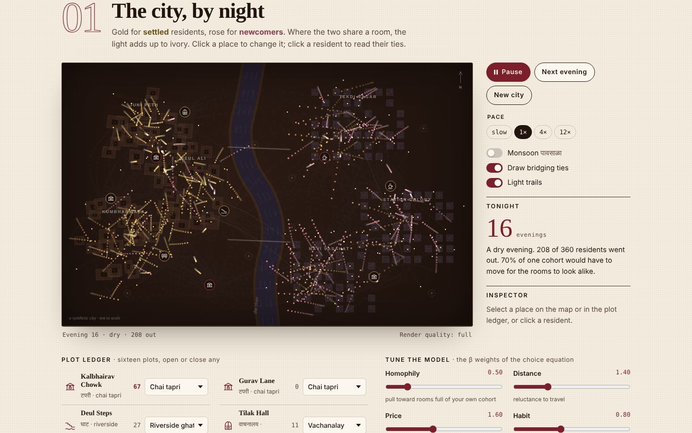
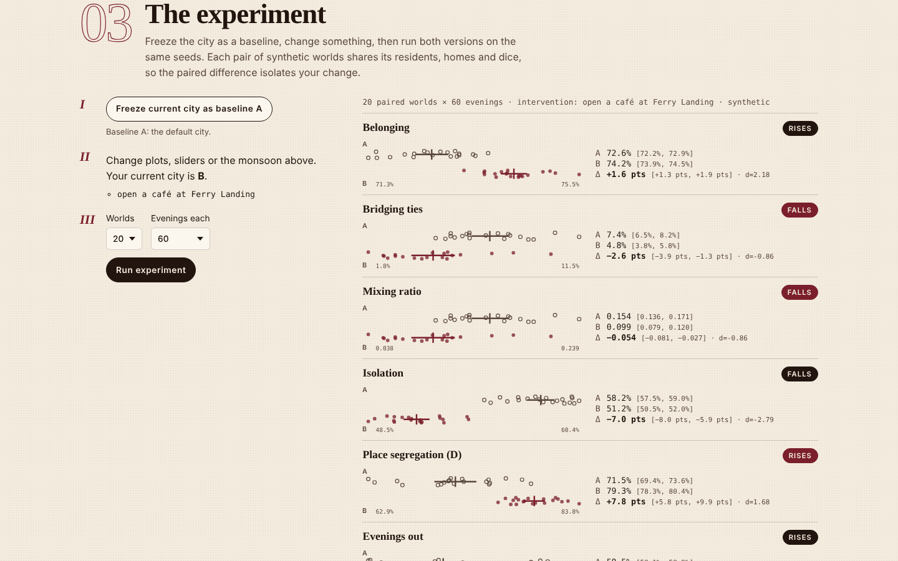
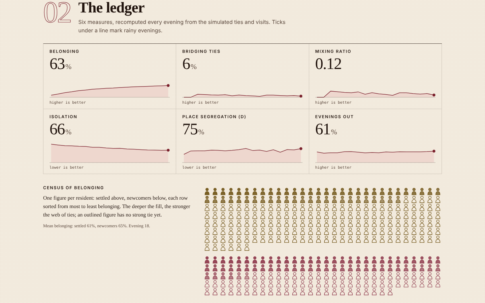
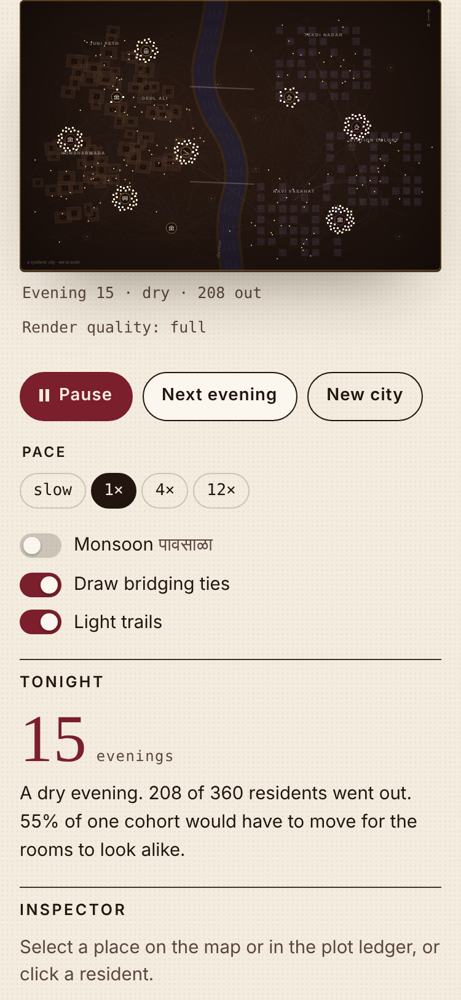

# KATTA · कट्टा

**An agent-based field laboratory for third places: build a small synthetic city of chai stalls, reading rooms, ghats, a single-screen cinema and cafés, watch 360 residents choose where to spend their evenings, and run paired Monte Carlo experiments on who comes to belong.**

SHRIYA.EXE · drop #002 · Live demo → https://shriyashekatkar25-byte.github.io/katta-lab/



*Katta* (कट्टा) is Marathi for a raised ledge, and by extension the regular spot where friends gather to talk. The sociologist Ray Oldenburg called such places *third places*: neither home nor work. This app asks a question from computational sociology: **when a city adds, prices or loses a third place, what happens to belonging, and to the ties that cross between groups?**

All data is synthetic. No parameter is calibrated to a real city or community; this is a toy for reasoning, labelled as such everywhere.

## What it does

- **The city, by night (Canvas 2D).** A procedurally drawn city split by a river: the old city as rotated courtyard (wada) blocks, the new township as a tower grid. Each evening residents walk out, linger in a golden-angle spiral around their place, and walk home. They are drawn as additive light (gold for settled residents, rose for newcomers), so where both cohorts share a room the light turns ivory. Conversations flicker between people in the same room; the strongest cross-cohort friendships are drawn as arcs between homes. Rain, adaptive render quality, reduced-motion mode.
- **Interventions.** Sixteen plots: open, change or close a tapri, vachanalay, ghat, single-screen or café, on the map or in an accessible plot ledger. Toggle the monsoon. Tune ten model weights (homophily, distance, price, habit, crowding, whim, forgetting, newcomer share, mixed housing, population).
- **The ledger.** Six measures recomputed every evening with sparklines: belonging, bridging ties, mixing ratio, isolation, place segregation (Duncan's D), evenings out. An isotype census draws one figure per resident, sorted by belonging.
- **The experiment bench.** Freeze a baseline A, change the city into B, run 10–40 paired synthetic worlds × 40–90 evenings in a Web Worker. Results: dot strips of every world, 95% t-intervals, a paired bootstrap interval for B − A, paired Cohen's d, and a verdict that knows which direction is good for each measure.
- **Field notes.** A rule-based narrator (no language model) writes up the city and the last experiment; every sentence maps to a threshold and a number.
- **Notebook and exports.** Save experiments in this browser, export the daily ledger as CSV and experiments as JSON. Inspector for any place or resident.



A result the model produced on its first serious run (20 paired worlds × 60 evenings, seed-fixed): opening a café at Ferry Landing **raised belonging (+1.6 pts) and cut isolation (−7.0 pts) while lowering bridging ties (−2.6 pts) and raising place segregation (+7.8 pts)**. More places to choose from made it easier for each cohort to sort. In Putnam's terms: more bonding, less bridging. It is a property of the toy, not a finding about any real city, and it is exactly the kind of trade-off the bench is built to expose.

| | |
|---|---|
|  |  |

## Run it

```bash
npm install
npm run dev      # local dev server
npm test         # Vitest unit tests
npm run build    # type-check + production build into docs/
```

## Architecture (summary)

TypeScript + Vite, no UI framework. All modelling is plain, DOM-free, tested code in `src/lib/`; the UI only renders state.

```
src/
  main.ts       state, controls, animation loop, worker client
  worker.ts     paired Monte Carlo off the main thread
  lib/          rng · model (logit choice, conversations, ties, metrics) · stats (t, bootstrap, Gini, D)
                experiment (common random numbers) · report (rule-based notes) · storage
  ui/           map (three-layer canvas) · charts (sparkline, isotype, dot strip) · glyphs (shared SVG/Path2D)
tests/          Vitest suites
```

The model in one line: each resident goes out with probability = sociability, then chooses among open places and home by a multinomial logit over appeal, distance, price, habit, homophily, crowding and rain; inside each place they start a few conversations; conversations become ties that fade. Full equations are on the page (section 05) and in [docs/ARCHITECTURE.md](docs/ARCHITECTURE.md). Art direction: [docs/DESIGN.md](docs/DESIGN.md). Product thinking: [CASE_STUDY.md](CASE_STUDY.md).

## Tech stack

TypeScript 5 · Vite 5 · Canvas 2D (additive compositing, Path2D) · SVG · Web Workers · localStorage · Vitest + jsdom · Python Playwright. Fonts: Fraunces, Space Grotesk, IBM Plex Mono, Tiro Devanagari Marathi (Google Fonts).

## Testing status

Recorded on the build that is published:

- `npx tsc --noEmit`: no errors.
- `npm test`: **35 tests passed in 4 files** (model 14, stats + RNG 11, storage + field notes 6, experiment bench 4). Includes: an A/A experiment returns exactly zero difference; stronger homophily raises segregation; a permanent monsoon lowers evenings out; ties are symmetric and decay; corrupted storage is repaired.
- `npm run build`: succeeded (JS 44 kB / 18 kB gzipped, worker 7.5 kB).
- Python Playwright (Chromium) against the built `docs/` at 1280×860 and 375×812: **21 scripted checks passed**: no horizontal scroll at either width, stepping, opening a place from the ledger and from a map click, resident inspector, sliders, monsoon, a full 10×40 experiment rendering six outcome rows, field notes, notebook save, census of 360 figures, persistence of plots / notebook / monsoon across reload, keyboard step, mobile plot change, reduced-motion (no autoplay).
- Console: no app errors. The sandbox that ran the checks could not reach Google Fonts, which logged 3 network errors for the font files; the pages fell back to system fonts there.

Not tested: real phones, Safari/Firefox, screen readers end-to-end.

## Credits

Visual research references and what was taken from each: [CREDITS.md](CREDITS.md). All glyphs, map drawing, charts and code are original.

---

Original work by Shriya Shekatkar · SHRIYA.EXE · Synthetic or demo data is labeled as such. Not affiliated with any film, studio or company. Studio gallery: https://shriyashekatkar25-byte.github.io/shriya-exe/
